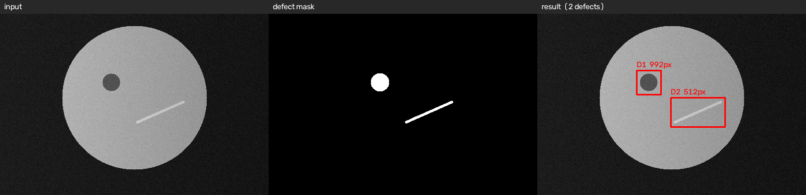

# 工件表面缺陷检测 demo

## 解决什么问题

用传统图像处理找出金属工件表面的凹坑和划痕，不依赖深度学习，
在普通笔记本上就能跑。适用于没有 GPU、也没有标注数据的小批量场景。

## 怎么跑

​```
pip install -r requirements.txt
python detect_defects.py
​```

## 结果



## 已知问题

- 目前用的是程序合成的图，还没在真实工业相机图片上验证
- 光照不均时有边缘误检，靠 k 值调参压制，不够鲁棒
- 只做了二分类，没有区分缺陷类型

## 接下来

- 换成真实图片
- 加入缺陷分类
